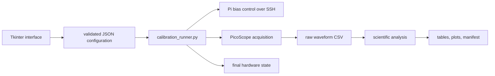

# Backend Guide

## Boundary Between Interface And Measurement

The interface collects values and starts one command. The backend validates the same values again, controls the run directory and hardware lifecycle, calls acquisition programs, and starts analysis. A command-line run therefore has the same safety and scientific checks as a run started from the window.

## Core Modules

### `calibration_core.py`

This is the shared foundation. It parses lists, checks ranges and relationships, formats commands, writes JSON, records timestamped logs, and runs cancellable child processes. `ConfigurationError` is raised before hardware is touched.

Important checks include:

- allowed PicoScope ranges;
- physical trigger below the selected full-scale range after attenuation;
- event-count and voltage bounds;
- unique detector and scope channels;
- equal positive signal and dark window widths;
- dark window contained in the waveform;
- minimum reference tracks not exceeding recorded events.

### `calibration_runner.py`

This is the run coordinator. A normal run follows the same order each time:

1. load and validate configuration;
2. acquire the local hardware lock;
3. create a time-stamped run directory;
4. save configuration and the initial manifest;
5. test PicoScope and SSH access;
6. stop competing temperature compensation when requested;
7. record environment and hardware plans;
8. set the requested bias and wait for settling;
9. acquire raw waveforms;
10. analyze the point without changing raw files;
11. update status and plots;
12. repeat for the next point;
13. apply the configured final hardware state in `finally`.

The final-state block runs after normal completion, an analysis error, most command failures, and user cancellation.

### Acquisition Programs

`automation/pico_capture.py` records one self-triggered channel for dark and Vbr work. `automation/pico_scintillator_capture.py` records four channels for a reference-particle event. Both also support synthetic data for dry runs.

The acquisition program saves the actual scope interval, ranges, trigger settings, and overflow information. Analysis must use saved metadata rather than assuming the request was applied exactly.

### Analysis Programs

- `analyze_point.py` measures event baselines, pulse heights and areas, identifies p.e. peaks, and reports point quality.
- `fit_vbr.py` performs the weighted p.e.-spacing line fit and propagates covariance to the zero-spacing intercept.
- `analyze_scintillator_zero.py` checks C-D reference coincidence, integrates equal signal and dark gates, calculates corrected zero-event efficiency, and estimates uncertainty.
- `calibration_plots.py` creates method-level summary figures from saved tables.

Analysis never deletes an event because it looks inconvenient. Rejected points and waveforms retain a reason that can be audited later.

## Pi Hardware Programs

The scripts in `pi/` convert requested voltage into the detector-specific MAX1932 high-side code and low-side DAC code. They are kept separate because their transfer constants and channel map belong to one readout. A calculated voltage message is not an independent measurement. Commissioning requires a meter check and a short conservative scan.

## Failure And Cancellation

The GUI sends `SIGTERM` to the runner process group. `CommandExecutor` forwards cancellation to the active child process. The runner then enters cleanup and requests the configured final hardware state. The operator must still verify physical voltage after a communication or hardware fault.

Partial runs remain on disk. Completed raw files, logs, and point status are evidence and are not removed automatically.

## Backend Development Checklist

When adding a setting or method:

1. validate before hardware access;
2. make units explicit in variable and command-line names;
3. save the requested and actual values;
4. preserve raw data;
5. record rejection reasons;
6. keep dry-run behavior representative;
7. test cancellation and final-state cleanup;
8. run `make check`.
